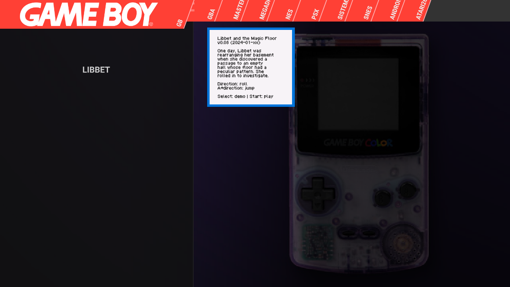
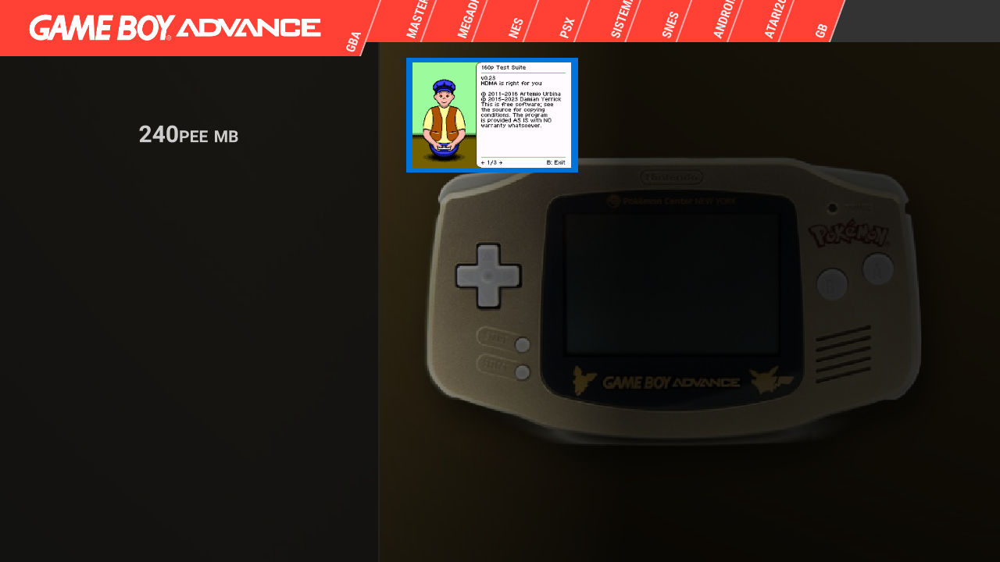
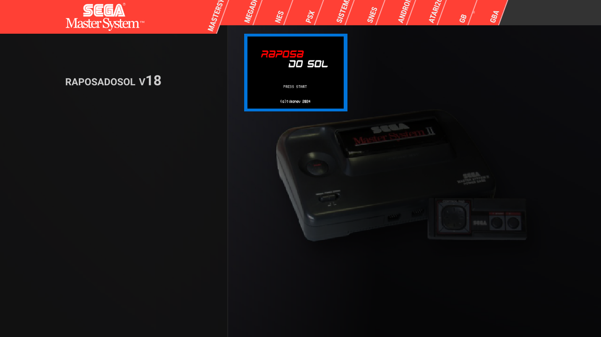
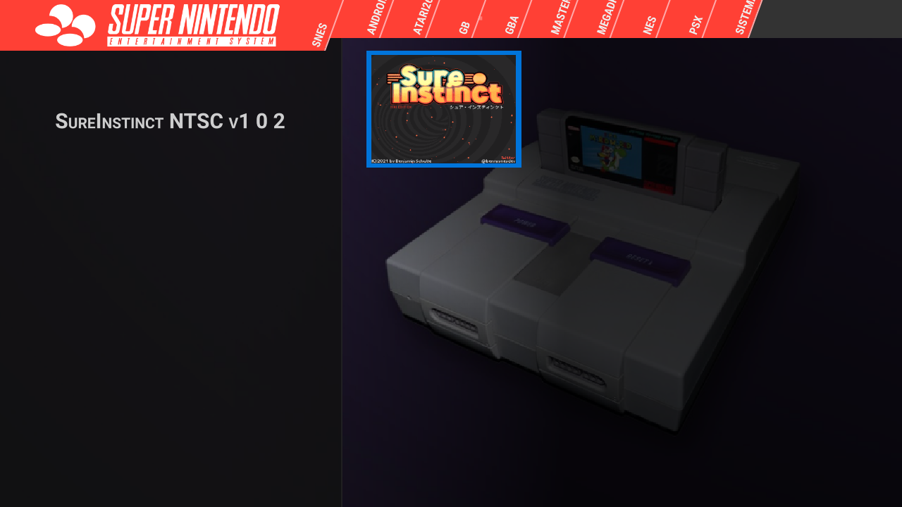
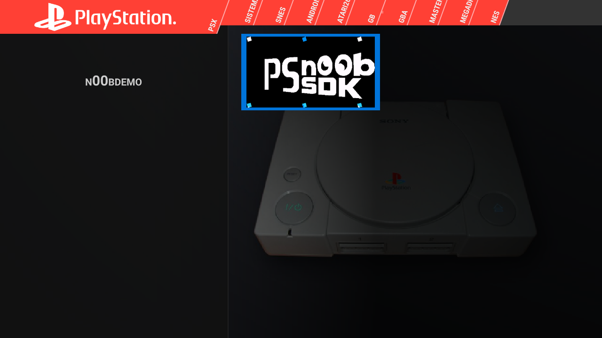
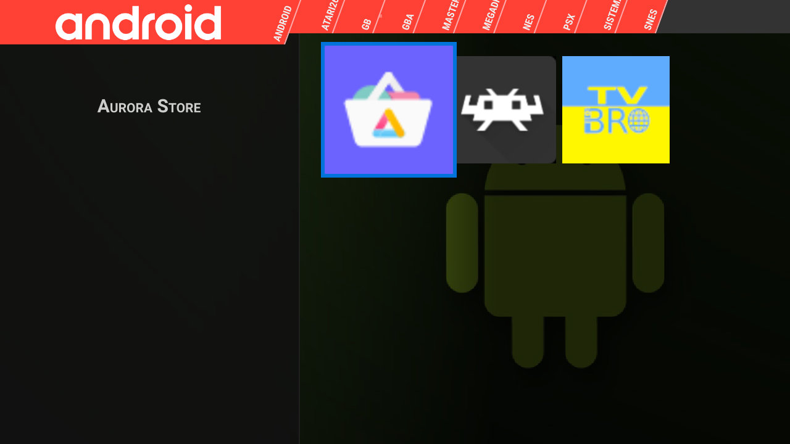
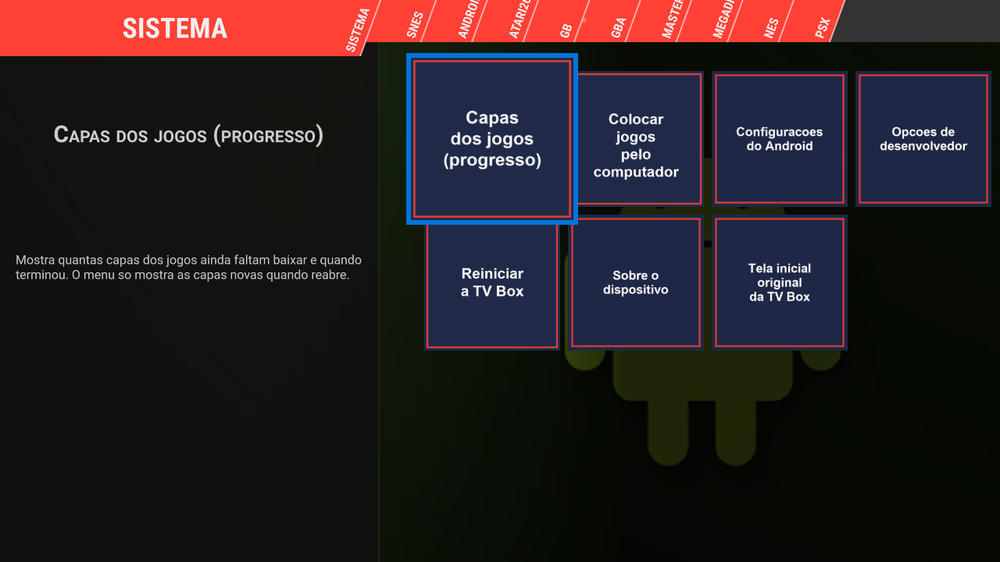

# RENBA — TV Box "MXQ Pro 4K" vira console retrô

**RENBA** é uma imagem Android 10 enxuta para **uma build específica de fábrica** da TV Box "MXQ Pro 4K" (Allwinner sun50iw9p1 / H313), já pronta para jogar: tela inicial **Pegasus** com uma aba por console e capas, **RetroArch** com 8 núcleos, 8 jogos de teste livres e atalhos para colocar jogos pelo computador **sem tirar o cartão SD**.

Consoles: NES, Game Boy / Color, Game Boy Advance, Super Nintendo, Mega Drive, Master System, Atari 2600 e PlayStation 1.

> **Projeto gratuito, feito por hobby, sem fins lucrativos. Não pode ser vendido** (alguns núcleos proíbem uso comercial). Veja `README_creditos.md` e `NOTICE`.

> **AVISOS GRAVES**
> - **Não oficial, sem garantia.** Um erro pode deixar a box sem boot. **Não existe caminho de recuperação testado** (FEL/PhoenixSuit e boot por cartão SD nunca foram testados; ver "Se der errado").
> - **Só serve para a build exata abaixo.** "MXQ Pro 4K 5G" é nome de vários lotes; outras boxes podem ter firmware/NAND diferentes. O `check_compat.sh` confere e o `flash_release.sh` recusa se não bater.
> - **NÃO ligue a porta USB da box a um computador** (ver `USB_PC_AVISO.md`). A instalação é por adb **pela rede**.
> - A imagem contém o firmware do fabricante e apps do Google (GMS) que já vinham na box. O build de fábrica é `eng`/`test-keys` (adbd root); esta imagem só exige autorização do adb, não a torna um sistema de produção.
> - **Fotos e imagens de terceiros** (fundos dos consoles, tela de boot "RENBA", robô do Android) estão incluídas por conta do autor. Donos que queiram a retirada: abram uma *issue*.
> - **Não há ROM comercial nem BIOS.** Use só jogos que você tem direito de usar.

## Como é
Uma aba por console, com capa e fundo. Os prints mostram só os jogos de teste livres que vêm na imagem (suas ROMs aparecem do mesmo jeito, com as capas baixadas).

| | |
|---|---|
|  |  |
|  |  |
|  |  |
|  | |

## Build compatível (conferida pelo `check_compat.sh`)
- `ro.board.platform=cupid`, `ro.product.device=titan-p1`
- `ro.build.display.id = titan_p1-eng 10 QP1A.191105.004 eng.akrd6.20210505.131222 test-keys`
- `by-name/super -> nand0p4`, 2147483648 bytes
- **sha256 do super de fábrica: `172e9203f1649f9d9c3fdc145141cffaee1e3294b4c200c078fdca2742298fb5`**
- Também é aceita como ponto de partida a [imagem limpa v1.0](https://github.com/shinjeikari/mxq-pro-4k-clean-rom) do mesmo autor (`5e1fa9fe…4d8a`).
- **sha256 da imagem final (`renba_super.img`): `923e16f04599e4a74e822e45dcf010e9958ac91eaf5ebcbc6230ff022b710cde`**

## Código-fonte dos scripts do sistema
Em `emu-scripts/`: `emu_firstboot.sh` (primeiro boot e todo boot), `emu_covers.sh` (capas), `emu_ftp_help.sh` (telas "Colocar jogos"/"Capas"/"Reiniciar"), `emu_refresh.sh` (atualiza o menu só se houve novidade), o serviço `emu_firstboot.rc`, o mapa do controle remoto e a lista de touchpads ignorados. São os mesmos que estão dentro da imagem.

## O que você precisa
- Computador com `adb`, `xz` e `sha256sum` (Linux, macOS ou Git Bash no Windows), na **mesma rede** da box. Na box, ligue "USBV device mode" nas opções de desenvolvedor (isso desativa o mouse/teclado da porta ao lado do AV até desligar) e autorize o adb na tela.
- **Um cartão SD (microSD em adaptador no slot da box), formatado em FAT32.** Todo o conteúdo (jogos, capas, saves, configurações do RetroArch) fica **no cartão**; a memória interna guarda só o sistema. Sem cartão, só as abas Android e Sistema aparecem.
- Energia estável (nobreak; nada de tirar da tomada durante a gravação).

## Passo a passo
1. Baixe todos os arquivos desta release na mesma pasta e confira: `sha256sum -c SHA256SUMS`
2. **Verificação de compatibilidade (só leitura):** `./check_compat.sh <ip>:5555` — precisa terminar com `COMPATIVEL`.
3. **Backup do seu super (obrigatório):**
   `adb exec-out "dd if=/dev/block/by-name/super bs=1048576" > meu_super_backup.img`
   e confira que o `sha256sum` dele é o hash de fábrica acima. Guarde fora da box.
4. Grave: `./flash_release.sh SIM <ip>:5555` — descompacta, confere o hash do super atual, grava **269 blocos** de 1 MiB, confere cada bloco e a imagem inteira. **Só se terminar com `TUDO OK`:** `adb reboot`.
5. Se aparecer qualquer `ERRO`: **não reinicie**; rode `./restore_backup.sh SIM meu_super_backup.img <ip>:5555`.
6. **Apague os dados do usuário:** Configurações do Android > Preferências do dispositivo > Redefinir (isso também apaga o Wi‑Fi e a autorização do adb: refaça-os depois), ou desinstale apps antigos: a imagem não mexe no `/data`. O primeiro boot instala o Pegasus, o RetroArch e o servidor FTP (3 a 6 minutos; **não desligue**). **Durante esse tempo a box mostra a tela inicial original, não o Pegasus**: é normal; o Pegasus abre sozinho quando termina.
7. Coloque o cartão SD (ver abaixo) e reinicie a box. O Pegasus abre sozinho como tela inicial.

## Primeiro uso
- **Cartão novo:** a box cria `ROMs/<sistema>/` no cartão. Os 8 jogos de teste ficam em `ROMs/`; coloque os seus em `ROMs/<sistema>/` (`nes`, `gb`, `gba`, `snes`, `megadrive`, `mastersystem`, `atari2600`, `psx`). Detalhes em `README_capas_e_pastas.md`.
- **Colocar jogos pelo computador (sem tirar o cartão):** aba **Sistema > Colocar jogos**. A box mostra o endereço FTP, o usuário e uma **senha gerada no primeiro boot**; abra o endereço no Explorador de Arquivos do computador, arraste os arquivos e, na TV, toque em **Terminei**. O menu se atualiza sozinho (jogos, fundos e capas).
- **Capas:** baixadas automaticamente (precisa de internet) do projeto libretro-thumbnails. A busca tolera nomes fora do padrão (ano, fabricante, `(PAL)`, `[a2]`): ela procura pelo título principal.
  **Hacks, traduções e jogos independentes não têm capa no banco online e não são baixados:** a capa tem de ser colocada à mão (`<sistema>/media/<nome do jogo>/boxFront.png`). A tela "Capas dos jogos" lista os jogos sem capa e tem o botão **Como colocar a capa à mão** com o passo a passo.
- **Aba Sistema:** Colocar jogos, Capas dos jogos, Reiniciar a TV Box (reinicia na hora), tela inicial original, Configurações, Sobre, Opções de desenvolvedor.

## Controles
Veja `README_controles.md`. Resumo:
- **Controle remoto IR:** botão **4** = aba anterior, **6** = próxima aba, **9** = ESC (no Pegasus abre o menu; no RetroArch, dois toques saem do jogo). **Atenção:** "Voltar" dentro do Pegasus fecha o app e causa uma tela branca (bug do Pegasus como tela inicial); use o 9. Se a tela branca aparecer, reinicie a box.
- **Controles de jogo:** DualShock 4 por cabo e adaptadores USB 8BitDo funcionam. **Select + Start** juntos, 2 vezes = sai do jogo. O touchpad do DS4/DS5 não vira ponteiro de mouse.
- **Bluetooth não funciona** (sem chip BT utilizável na box). **Armazenamento USB em massa (pendrive/leitor) não foi reconhecido** nas portas testadas; use o cartão SD.

## O que há na imagem
- Base: a imagem "limpa v1.0" (sem os apps de adware de fábrica, sem `/system/preinstall`, sem gerenciador de arquivos nem OTA do fabricante; `ro.adb.secure=1`, swap em zram, tela de boot nova).
- Adicionados: Pegasus Frontend (alpha16), RetroArch 32 bits, núcleos fceumm, gambatte, mgba, snes9x, genesis_plus_gx, picodrive, pcsx_rearmed e stella, TV Bro 2.1.6, Aurora Store 4.8.4, Primitive FTPd, scripts `emu_*` em `/system/bin` e os dados em `/system/etc/emu`.
- Jogos de teste (todos livres/homebrew): Thwaite, Libbet and the Magic Floor, 240p Test Suite, Sure Instinct, Platformer (SGDK), n00bdemo, Raposa do Sol, Berta and Butterflies. **Nenhuma ROM comercial, nenhuma BIOS.**

## Estado dos testes (honesto)
Tudo foi testado numa única box (a do autor), em 24–27/10/2026.

| Item | Resultado |
|---|---|
| Gravação incremental da imagem na box (script do autor, ~25 versões, conferência bloco a bloco) | OK; releitura total da partição = 0 diferenças na versão final |
| Primeiro boot com `/data` apagado e cartão SD (apps, núcleos, FTP, capas) | OK, ~3 min |
| Boot sem cartão SD | Abre direto no Pegasus com as abas Android e Sistema |
| Pegasus, RetroArch e os 8 núcleos com os jogos de teste | OK; save state OK |
| Controles listados em `README_controles.md` | OK nos modelos marcados; DS4 por cabo verificado, os demais relatados pelo usuário |
| FTP com senha; envio de vários arquivos de uma vez pelo Explorador do Windows | OK (5–6 envios em paralelo) |
| Download de capas e busca por título principal | OK (exceto hacks/traduções/independentes: sem capa online) |
| Atalhos da aba Sistema (inclui reinício imediato) | OK |
| `restore_backup.sh` + `check_compat.sh` + `flash_release.sh` desta versão, numa box real: restaurar o firmware de fábrica, `COMPATIVEL`, gravar os blocos | OK (27/10/2026), feito com a build anterior (`4e5168d2…`, 270 blocos), que difere desta só por uma linha do `emu_firstboot.sh` (correção do botão **Terminei**, testada depois na box). A lista de 269 blocos desta versão foi conferida só offline (firmware de fábrica ou imagem limpa + blocos = hash final). O Wi‑Fi caiu 3 vezes durante os testes; por isso o `flash_release.sh` agora **retoma sozinho** (arquivo `.flash_progress`) e tenta de novo, e o `restore_backup.sh` pode ser rodado de novo para continuar |
| Redefinir pelas Configurações (Preferências do dispositivo > Redefinir) e primeiro boot do zero **sem** cartão SD | OK (27/10/2026): ~5 min com a tela inicial original, depois o Pegasus abriu sozinho com Android + Sistema; FTP criado na memória interna. É preciso refazer Wi‑Fi e opções de desenvolvedor (adb) |
| Outras boxes / outros firmwares / outros lotes | **nunca testado** |
| Boot por cartão SD, FEL/PhoenixSuit, recovery de fábrica | **nunca testado** |
| USB-peripheral com o PC | **não funciona nesta box** (hardware); ver `USB_PC_AVISO.md` |
| Desempenho com 1 GB de RAM | PS1 e jogos pesados podem engasgar; o Pegasus pode ser fechado pelo sistema se o TV Bro estiver na frente por muito tempo |

## Se der errado (a box não inicia)
**Recuperação com a box sem boot: nada disso foi feito nem testado; não prometemos recuperação.** O `restore_backup.sh` só funciona enquanto a box ainda liga e aceita adb pela rede (foi testado nessa situação).

O U-Boot (`bootloader`), o `boot` e o `recovery` **não são alterados**: só a partição `super` muda. Mesmo assim, se a box não subir o Android, **não há método de recuperação testado**. Hipóteses não verificadas: recovery de fábrica (`nand0p6`); cartão SD de boot do Allwinner; FEL por USB (a porta da box não é detectada pelo PC). Por isso o backup do passo 3 é obrigatório.

## Arquivos desta release
`renba_super.img.xz` (imagem, ~635 MB), `blocks.txt`, `flash_release.sh`, `check_compat.sh`, `restore_backup.sh`, `SHA256SUMS`, `USB_PC_AVISO.md`, `README_controles.md`, `README_capas_e_pastas.md`, `README_creditos.md`, `FEATURES.md` (o que a imagem faz), `CHANGELOG.md` (histórico das versões), `NOTICE`.

## Créditos e licenças
Muito obrigado a quem escreveu e liberou os projetos usados: Android/AOSP, Pegasus Frontend, RetroArch/Libretro, os autores de cada núcleo, Aurora Store, TV Bro, Primitive FTPd, libretro-thumbnails e os autores dos jogos de teste. Lista completa, licenças e links em `README_creditos.md`. Os núcleos Snes9x, Genesis Plus GX e PicoDrive **proíbem uso comercial**; por isso esta imagem **não pode ser vendida**. O código-fonte dos componentes GPL/MPL está nos repositórios linkados em `README_creditos.md`.

## English (short)
Unofficial retro-gaming image for one specific "MXQ Pro 4K" firmware build (hashes above): Pegasus frontend + RetroArch with 8 libretro cores (NES, GB/GBC, GBA, SNES, Mega Drive, Master System, Atari 2600, PS1), 8 free homebrew test ROMs, and an on-box FTP shortcut to add games to the SD card from a PC. All user content lives on the SD card. Free, non-commercial only (some cores forbid commercial use). Tested on a single unit; the flash and restore scripts of this exact version have **not** been run on a factory-state box (the block list was verified offline), other units are untested, and there is no tested recovery path. Back up your `super` first, run `check_compat.sh`, and never connect the box's USB port to a PC (`USB_PC_AVISO.md`). Contains OEM firmware and Google apps; third-party images (backgrounds, boot animation, Android robot, CC BY 4.0) are included at the author's responsibility. No commercial ROMs or BIOS.
